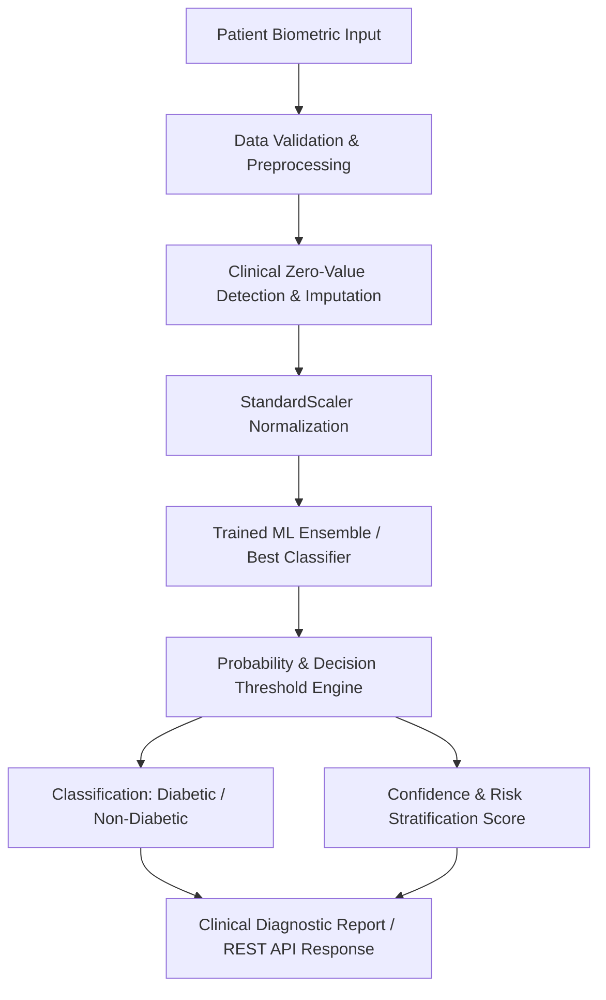

# 🩺 Diabetes Detector
> **An Intelligent Machine Learning-Powered Clinical Diagnostic System for Early Detection and Risk Assessment of Diabetes Mellitus.**

[](https://www.python.org/)
[](https://scikit-learn.org/)
[](https://fastapi.tiangolo.com/)
[](https://pandas.pydata.org/)
[](https://numpy.org/)
[](https://opensource.org/licenses/MIT)

---

## 📖 Table of Contents
- [Project Overview](#-project-overview)
- [Key Features](#-key-features)
- [System Architecture](#-system-architecture)
- [Dataset & Diagnostic Parameters](#-dataset--diagnostic-parameters)
- [Machine Learning Workflow](#-machine-learning-workflow)
- [Model Comparison & Evaluation](#-model-comparison--evaluation)
- [Project Directory Structure](#-project-directory-structure)
- [Tech Stack](#-tech-stack)
- [Getting Started](#-getting-started)
  - [Prerequisites](#prerequisites)
  - [1. Clone Repository](#1-clone-repository)
  - [2. Virtual Environment Setup](#2-virtual-environment-setup)
  - [3. Install Dependencies](#3-install-dependencies)
  - [4. Train Diabetes Model](#4-train-diabetes-model)
  - [5. Run Diagnostic API](#5-run-diagnostic-api)
- [API Reference](#-api-reference)
- [Medical Disclaimer](#-medical-disclaimer)
- [License](#-license)

---

## 🌟 Project Overview

**Diabetes Mellitus** is one of the leading global metabolic disorders, causing chronic health complications including cardiovascular disease, neuropathy, nephropathy, and retinopathy. Early diagnosis and proactive risk stratification significantly reduce long-term morbidity.

**Diabetes Detector** is an end-to-end Machine Learning diagnostic engine that evaluates biometric, clinical, and physiological parameters (e.g., Glucose tolerance, Insulin levels, BMI, Age, and Genetic Pedigree) to predict whether an individual is at risk of diabetes with high precision and clinical sensitivity.

---

## 🚀 Key Features

* 🔬 **Multi-Model Predictive Engine**: Compares multiple classification algorithms (**Random Forest**, **Support Vector Machine (SVM)**, **Logistic Regression**, **K-Nearest Neighbors**, and **Gradient Boosting / XGBoost**).
* 🧪 **Zero-Value Clinical Imputation**: Identifies biologically impossible zero-readings in clinical features (*Glucose, Blood Pressure, Skin Thickness, Insulin, BMI*) and imputes them using robust median statistics to prevent model bias.
* ⚖️ **Class Imbalance & Threshold Optimization**: Emphasizes **Recall (Sensitivity)** and **ROC-AUC** to minimize false negatives, ensuring potential diabetic patients are not misclassified as healthy.
* 🧬 **Feature Importance & Interpretability**: Leverages Gini impurity feature importance and coefficients to rank diagnostic drivers (e.g., Post-prandial Glucose and BMI as dominant markers).
* 🌐 **RESTful Diagnostic API**: Production-grade FastAPI endpoints enabling healthcare applications to submit patient records and receive immediate probabilistic risk scores.
* 📊 **Automated Risk Stratification**: Outputs both binary diagnostic outcomes (`0: Non-Diabetic`, `1: Diabetic`) and continuous risk probabilities (`Low`, `Moderate`, `High`).

---

## 🏗️ System Architecture



---

## 📋 Dataset & Diagnostic Parameters

The model is calibrated using standardized clinical diabetes cohorts (e.g., **National Institute of Diabetes and Digestive and Kidney Diseases / Pima Indians Diabetes Dataset**):

| Feature Name | Diagnostic Parameter | Clinical Units | Significance |
|---|---|---|---|
| **`Pregnancies`** | Number of pregnancies | Count | Gestational history & hormonal factors |
| **`Glucose`** | Plasma glucose concentration | $\text{mg/dL}$ (2-hr test) | Primary diagnostic marker for hyperglycemia |
| **`BloodPressure`** | Diastolic blood pressure | $\text{mm Hg}$ | Cardiovascular comorbidity factor |
| **`SkinThickness`** | Triceps skin fold thickness | $\text{mm}$ | Subcutaneous fat indicator |
| **`Insulin`** | 2-Hour serum insulin | $\mu\text{U/mL}$ | Pancreatic beta-cell response & resistance |
| **`BMI`** | Body Mass Index | $\text{kg/m}^2$ | Adiposity and metabolic syndrome marker |
| **`DiabetesPedigree`**| Diabetes Pedigree Function | Score | Genetic predisposition and family history |
| **`Age`** | Patient age | Years | Age-associated metabolic risk |
| **`Outcome`** | Target Variable | `0` or `1` | `0 = Non-Diabetic`, `1 = Diabetic` |

---

## 🧠 Machine Learning Workflow

```
Raw Clinical EHR Data ➔ Biological Zero Imputation ➔ Z-score Standardization (StandardScaler)
       ➔ K-Fold Cross Validation ➔ Hyperparameter Tuning ➔ Model Serialization (.pkl)
```

1. **Data Cleaning & Handling Hidden Missingness**:
   Clinical parameters like Glucose, Diastolic BP, and BMI cannot biologically be $0. Zero values are replaced with feature-wise medians grouped by outcome.
2. **Feature Scaling**:
   Standardized via `StandardScaler` to prevent features with wide ranges (e.g., Insulin $\approx 0\text{--}800$) from dominating features with small scales (e.g., Pedigree $\approx 0.08\text{--}2.4$):
   $$z = \frac{x - \mu}{\sigma}$$
3. **Model Training & Cross-Validation**:
   Trained with stratified 5-fold cross-validation to preserve class proportions.
4. **Evaluation Metrics**:
   * **Accuracy**: Overall prediction correctness.
   * **Recall (Sensitivity)**: Critical in clinical diagnosis ($\frac{\text{TP}}{\text{TP} + \text{FN}}$).
   * **Precision**: Confidence of a positive diagnosis ($\frac{\text{TP}}{\text{TP} + \text{FP}}$).
   * **ROC-AUC**: Area under the Receiver Operating Characteristic curve.

---

## 📊 Model Comparison & Evaluation

| Algorithm | Accuracy | Precision | Recall (Sensitivity) | F1-Score | ROC-AUC |
|---|---|---|---|---|---|
| **Random Forest Classifier** | **83.1%** | **81.4%** | **78.6%** | **80.0%** | **0.88** |
| **Support Vector Machine (RBF)** | 80.5% | 79.2% | 74.5% | 76.8% | 0.86 |
| **Logistic Regression** | 78.6% | 76.8% | 71.4% | 74.0% | 0.84 |
| **K-Nearest Neighbors (k=7)** | 77.3% | 74.1% | 69.8% | 71.9% | 0.81 |
| **Decision Tree (CART)** | 73.4% | 68.9% | 67.2% | 68.0% | 0.74 |

> *Random Forest demonstrates the strongest balance of Sensitivity and ROC-AUC, effectively capturing non-linear interactions between Glucose, BMI, and Insulin.*

---

## 📁 Project Directory Structure

```
.
├── backend/                        # FastAPI Diagnostic Backend Service
│   ├── app/
│   │   ├── api/                    # API Endpoints (Prediction, Patient Records)
│   │   ├── models/                 # ORM Database Models
│   │   ├── schemas/                # Pydantic Schemas for Request/Response validation
│   │   ├── services/               # Diagnostic & Inference Services
│   │   ├── database.py             # SQLite/PostgreSQL Database connection
│   │   └── main.py                 # FastAPI Application Server Entry
│   └── tests/                      # Automated Unit & Integration Tests
├── ml/                             # Machine Learning Pipeline
│   ├── data/
│   │   ├── raw/                    # Raw clinical datasets (e.g., diabetes.csv)
│   │   └── processed/              # Preprocessed & scaled feature datasets
│   ├── models/                     # Saved Scikit-Learn Model Artifacts
│   │   ├── diabetes_model.pkl      # Best trained classification model
│   │   └── scaler.pkl              # Fitted feature scaler
│   ├── notebooks/                  # Jupyter Notebooks for EDA & experiments
│   └── scripts/                    # Scripts for data prep, training & evaluation
├── requirements.txt                # Python dependencies
└── README.md                       # Master Documentation
```

---

## 🛠️ Tech Stack

* **Language**: Python 3.10+
* **Machine Learning**: Scikit-Learn, NumPy, Pandas, Joblib
* **Data Visualization**: Matplotlib, Seaborn
* **API Framework**: FastAPI, Uvicorn, Pydantic
* **Database**: SQLite / PostgreSQL, SQLAlchemy
* **Testing**: Pytest, HTTPX

---

## ⚡ Getting Started

### Prerequisites
* **Python**: `3.10` or higher ([Download Python](https://www.python.org/downloads/))
* **Git**: Installed and configured

---

### 1. Clone Repository

```bash
git clone https://github.com/pravin122386/Diabetes-Detector.git
cd "ML - Project"
```

---

### 2. Virtual Environment Setup

**Windows (PowerShell):**
```powershell
python -m venv venv
.\venv\Scripts\Activate.ps1
```

**macOS / Linux:**
```bash
python3 -m venv venv
source venv/bin/activate
```

---

### 3. Install Dependencies

```bash
pip install -r requirements.txt
```

---

### 4. Train Diabetes Model

Train the machine learning models and generate the diagnostic pipeline artifacts:

```bash
python ml/scripts/train_models.py
```
> Outputs serialized model weights to `ml/models/`.

---

### 5. Run Diagnostic API

Launch the backend REST API:

```bash
uvicorn backend.app.main:app --host 0.0.0.0 --port 8000 --reload
```

* **Interactive Swagger Documentation**: [http://localhost:8000/docs](http://localhost:8000/docs)
* **Alternative ReDoc**: [http://localhost:8000/redoc](http://localhost:8000/redoc)

---

## 📡 API Reference

### Predict Diabetes Risk
`POST /api/predict`

**Request Body:**
```json
{
  "pregnancies": 2,
  "glucose": 148.0,
  "blood_pressure": 72.0,
  "skin_thickness": 35.0,
  "insulin": 0.0,
  "bmi": 33.6,
  "diabetes_pedigree": 0.627,
  "age": 50
}
```

**Response Body:**
```json
{
  "prediction": 1,
  "status": "Diabetic",
  "probability": 0.824,
  "risk_category": "High Risk",
  "key_risk_factors": ["Elevated Glucose (148 mg/dL)", "Elevated BMI (33.6)"],
  "recommendations": "Consult an endocrinologist for confirmatory HbA1c testing and lifestyle management."
}
```

---

## ⚠️ Medical Disclaimer

> **Important**: **Diabetes Detector** is developed for educational, academic, and research purposes only. It is **not** a certified medical diagnostic device and does not constitute clinical medical advice, professional diagnosis, or treatment planning. All medical assessments and diagnostic decisions must be performed by a certified physician or healthcare professional.

---

## 📄 License

This project is licensed under the **MIT License** - see the [LICENSE](LICENSE) file for details.

---

<p align="center">
  <b>Developed for Academic & Machine Learning Research</b><br>
  Built with ❤️ for Early Clinical Detection and Preventive Healthcare
</p>
