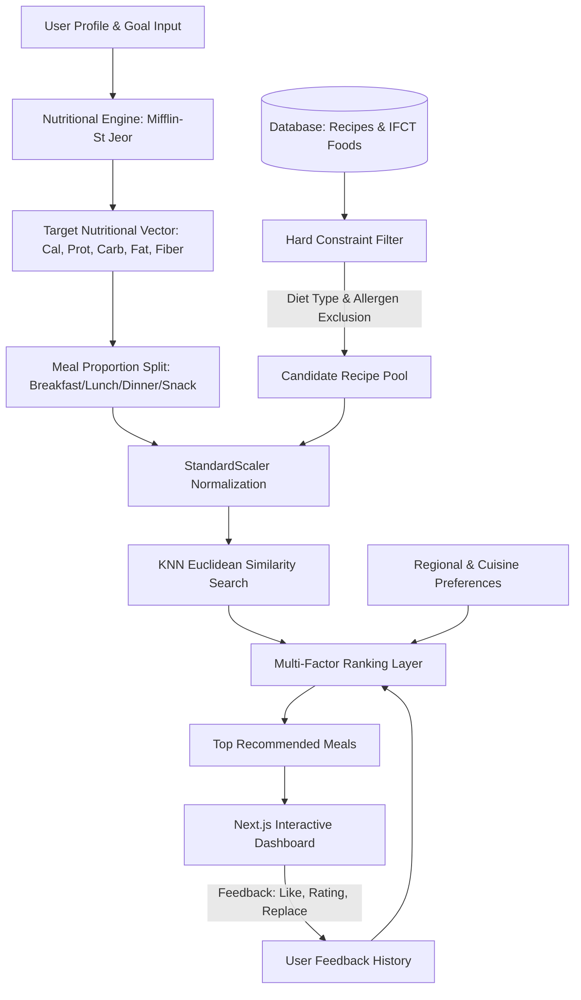

# 🥗 Personalized Indian Meal Recommendation System
> **An Intelligent, Science-Backed Dietary Recommendation Platform Powered by Machine Learning and Real ICMR-NIN Food Composition Data.**

[](https://www.python.org/)
[](https://fastapi.tiangolo.com/)
[](https://nextjs.org/)
[](https://www.typescriptlang.org/)
[](https://scikit-learn.org/)
[](https://tailwindcss.com/)
[](https://opensource.org/licenses/MIT)

---

## 📖 Table of Contents
- [Project Overview](#-project-overview)
- [Key Features](#-key-features)
- [System Architecture](#-system-architecture)
- [Data Provenance & Scientific Foundation](#-data-provenance--scientific-foundation)
- [Machine Learning Pipeline](#-machine-learning-pipeline)
- [Project Directory Structure](#-project-directory-structure)
- [Tech Stack](#-tech-stack)
- [Getting Started](#-getting-started)
  - [Prerequisites](#prerequisites)
  - [1. Clone Repository](#1-clone-repository)
  - [2. Backend Setup & Dependencies](#2-backend-setup--dependencies)
  - [3. Database Initialization & Seeding](#3-database-initialization--seeding)
  - [4. Train ML Models](#4-train-ml-models)
  - [5. Run Backend Server](#5-run-backend-server)
  - [6. Frontend Setup & Launch](#6-frontend-setup--launch)
- [API Reference](#-api-reference)
- [Testing & Quality Assurance](#-testing--quality-assurance)
- [ML Experimentation & Jupyter Notebook](#-ml-experimentation--jupyter-notebook)
- [Medical Disclaimer](#-medical-disclaimer)
- [License](#-license)

---

## 🌟 Project Overview

Traditional dietary recommendation systems often rely on Western nutritional profiles or generic caloric counters that fail to capture the complexity and diversity of Indian regional cuisines. 

The **Personalized Indian Meal Recommendation System** bridges this gap by marrying real nutritional chemistry from the **Indian Food Composition Tables (IFCT 2017)** with machine learning (K-Means clustering and K-Nearest Neighbors similarity matching). It calculates individual **Basal Metabolic Rate (BMR)** and **Total Daily Energy Expenditure (TDEE)**, strictly enforces allergen and dietary constraints, and delivers culturally resonant, meal-specific recommendations across **North, South, East, West, and Central Indian cuisines**.

---

## 🚀 Key Features

* 🧮 **Scientific Energy & Macro Estimation**: Implements the clinically validated **Mifflin-St Jeor equation** with activity multipliers and goal adjustments (weight loss deficit, maintenance, muscle gain surplus).
* 🛡️ **Zero-Compromise Safety Filtering**: Enforces hard constraints eliminating dishes containing flagged allergens (*Peanuts, Dairy, Gluten, Mustard, Tree Nuts, Eggs, Fish, Sesame*) or conflicting dietary lifestyles (*Vegetarian, Vegan, Non-Vegetarian*).
* 🤖 **Dual-Layer Machine Learning**:
  * **K-Means Clustering**: Groups recipes by 5-dimensional macronutrient density (*Calories, Protein, Carbohydrates, Fat, Fiber*) evaluated using silhouette scores.
  * **KNN Feature Matching**: Calculates Euclidean proximity between a user's target meal macronutrient vector and scaled recipe profiles.
* 📊 **Transparent Multi-Factor Ranking**: Ranks candidates using an explainable weighted scoring formula combining nutritional similarity (60%), cuisine preference (20%), regional alignment (10%), and interactive user feedback (10%).
* 🔄 **Adaptive User Feedback Loop**: Learns from user ratings, likes, and meal replacements to refine future recommendations.
* 🍱 **Comprehensive Regional Indian Catalog**: Curated Indian recipes spanning regional preparations with granular ingredient breakdowns and macronutrient profiles.
* 💻 **Modern Responsive Frontend**: Built with **Next.js 16**, **React 19**, **Tailwind CSS v4**, and **Recharts** for intuitive health dashboarding.

---

## 🏗️ System Architecture



---

## 🔬 Data Provenance & Scientific Foundation

This project relies on verified food chemistry standards, avoiding fabricated or synthetic nutritional figures:

1. **IFCT 2017 (Indian Food Composition Tables)**:
   * Sourced from the **National Institute of Nutrition (NIN)**, **Indian Council of Medical Research (ICMR)**.
   * Granular composition across 12 food groups (Cereals, Millets, Pulses, Leafy Vegetables, Tubers, Nuts, Milk products, etc.) calibrated per 100g.
2. **INDB (Indian Nutrient Databank)**:
   * Recipe-level formulations for traditional multi-ingredient Indian dishes with realistic standard portion sizes, macro splits, and allergen tags.

---

## 🧠 Machine Learning Pipeline

```
Raw CSV Datasets ➔ Validation & Cleaning ➔ 5D Feature Scaling (StandardScaler)
       ➔ K-Means Cluster Optimization (Silhouette Metric) ➔ KNN Similarity Search
```

1. **Feature Space**: Each dish is characterized by a 5-dimensional vector:
   $$\vec{x} = [\text{Calories}, \text{Protein (g)}, \text{Carbohydrates (g)}, \text{Fat (g)}, \text{Fiber (g)}]$$
2. **Feature Scaling**: Scaled using `StandardScaler` to normalize varied nutrient magnitudes:
   $$z = \frac{x - \mu}{\sigma}$$
3. **Clustering (K-Means)**:
   * Optimized across $k \in [2, 8]$ using **WCSS (Inertia)** and **Silhouette Score**.
   * Identifies natural nutritional archetypes (e.g., protein-dense, balanced staples, light snacks).
4. **Target Matching (KNN Euclidean)**:
   $$d(\vec{u}_{\text{target}}, \vec{r}_{\text{recipe}}) = \sqrt{\sum_{i=1}^{5} (u_i - r_i)^2}$$
5. **Explainable Scoring Engine**:
   $$\text{Score} = 0.60 \cdot S_{\text{similarity}} + 0.20 \cdot S_{\text{cuisine}} + 0.10 \cdot S_{\text{region}} + 0.10 \cdot S_{\text{feedback}}$$

---

## 📁 Project Directory Structure

```
.
├── backend/                        # FastAPI Application
│   ├── app/
│   │   ├── api/                    # REST API Endpoints
│   │   │   ├── feedback.py         # Feedback and meal replacement endpoints
│   │   │   ├── nutrition.py        # BMR / TDEE calculation endpoint
│   │   │   ├── recipes.py          # Recipe search & catalog endpoints
│   │   │   ├── recommendations.py  # Recommendation generation endpoint
│   │   │   └── users.py            # User profile management endpoints
│   │   ├── ml/
│   │   │   └── model_loader.py     # Singleton loader for trained ML models
│   │   ├── models/
│   │   │   └── database_models.py  # SQLAlchemy ORM models
│   │   ├── schemas/
│   │   │   └── pydantic_schemas.py # Pydantic v2 validation models
│   │   ├── services/
│   │   │   ├── filtering_service.py # Allergen & diet rule-based filtering
│   │   │   ├── nutrition_service.py # BMR, TDEE & macro target math
│   │   │   ├── ranking_service.py   # Multi-factor score formulation
│   │   │   └── recommendation_service.py # End-to-end orchestration pipeline
│   │   ├── database.py             # SQLite / PostgreSQL engine & session setup
│   │   └── main.py                 # FastAPI application root & CORS
│   └── tests/                      # Automated test suite
│       ├── test_api.py             # Integration tests for FastAPI endpoints
│       ├── test_filtering.py       # Unit tests for allergen & diet filtering
│       └── test_nutrition.py       # Unit tests for Mifflin-St Jeor formulas
├── database/                       # Database schema & migrations
│   ├── schema.sql                  # DDL SQL schema
│   ├── seed.sql                    # SQL seed insert statements
│   └── seed_database.py            # Automatic SQLite seeding script
├── frontend/                       # Next.js 16 App Router Application
│   ├── app/
│   │   ├── dashboard/              # Nutrition tracking & recommended meal views
│   │   ├── history/                # Saved meals and feedback logs
│   │   ├── meals/                  # Meal recommendation explorer
│   │   ├── onboarding/             # Interactive user onboarding questionnaire
│   │   ├── profile/                # User biometrics & dietary settings
│   │   ├── recipes/                # Recipe database catalog with search
│   │   ├── layout.tsx              # Root app layout
│   │   └── page.tsx                # Hero landing page
│   ├── components/                 # Reusable UI components (Navbar, Footer, Cards)
│   ├── lib/                        # API client & utilities
│   ├── package.json                # Frontend dependencies
│   └── tsconfig.json               # TypeScript configuration
├── ml/                             # Machine Learning artifacts & scripts
│   ├── data/
│   │   ├── raw/                    # Original raw IFCT & INDB datasets
│   │   └── processed/              # Cleaned and validated CSV files
│   ├── models/                     # Serialized scikit-learn model pickles
│   │   ├── kmeans.pkl              # Fitted K-Means clustering model
│   │   ├── knn.pkl                 # Fitted NearestNeighbors model
│   │   └── scaler.pkl              # Fitted StandardScaler transformer
│   ├── notebooks/
│   │   └── food_recommendation.ipynb # 12-step EDA & model evaluation notebook
│   └── scripts/
│       ├── generate_notebook.py    # Automated notebook builder
│       ├── prepare_data.py         # Raw data extraction & initial normalization
│       ├── process_data.py         # Validation & constraint cleaning pipeline
│       └── train_models.py         # Scaler, K-Means & KNN training script
├── requirements.txt                # Python backend & ML dependencies
└── README.md                       # Master project documentation
```

---

## 🛠️ Tech Stack

| Layer | Technologies |
|---|---|
| **Backend Framework** | FastAPI (Python 3.10+), Uvicorn |
| **Data Validation** | Pydantic v2 |
| **ORM & Database** | SQLAlchemy 2.0, SQLite (default) / PostgreSQL |
| **Machine Learning** | Scikit-Learn, NumPy, Pandas, Joblib |
| **Frontend Framework** | Next.js 16 (App Router), React 19, TypeScript |
| **Styling & Icons** | Tailwind CSS v4, Lucide React |
| **Data Visualization** | Recharts |
| **Testing** | Pytest, HTTPX, FastAPI TestClient |

---

## ⚡ Getting Started

Follow these step-by-step instructions to set up and run the system locally.

### Prerequisites
* **Python**: `3.10` or higher ([Download Python](https://www.python.org/downloads/))
* **Node.js**: `18.18` or higher ([Download Node.js](https://nodejs.org/))
* **Git**: Installed and configured

---

### 1. Clone Repository

```bash
git clone https://github.com/pravin122386/Diabetes-Detector.git
cd "ML - Project"
```

---

### 2. Backend Setup & Dependencies

Create and activate a Python virtual environment:

**On Windows (PowerShell):**
```powershell
python -m venv venv
.\venv\Scripts\Activate.ps1
```

**On macOS / Linux:**
```bash
python3 -m venv venv
source venv/bin/activate
```

Install backend and machine learning dependencies:
```bash
pip install -r requirements.txt
```

---

### 3. Database Initialization & Seeding

Seed the SQLite database (`backend/app/meal_rec.db`) with IFCT 2017 nutritional records and INDB recipes:

```bash
python database/seed_database.py
```
> This populates `foods` and `recipes` tables and generates `database/seed.sql`.

---

### 4. Train ML Models

Train the `StandardScaler`, optimal `K-Means`, and `KNN` models:

```bash
python ml/scripts/train_models.py
```
> Generates serialized artifacts in `ml/models/`: `scaler.pkl`, `kmeans.pkl`, and `knn.pkl`.

---

### 5. Run Backend Server

Start the FastAPI application with auto-reloading:

```bash
uvicorn backend.app.main:app --host 0.0.0.0 --port 8000 --reload
```

* **API Root**: [http://localhost:8000](http://localhost:8000)
* **Interactive OpenAPI Docs (Swagger)**: [http://localhost:8000/docs](http://localhost:8000/docs)
* **Alternative API Docs (ReDoc)**: [http://localhost:8000/redoc](http://localhost:8000/redoc)

---

### 6. Frontend Setup & Launch

Open a separate terminal, navigate to the `frontend/` directory, install packages, and launch the dev server:

```bash
cd frontend
npm install
npm run dev
```

* **Frontend Application**: [http://localhost:3000](http://localhost:3000)

---

## 📡 API Reference

### Root Endpoint
* `GET /`: Health check, active ML models, and dataset provenance.

### 1. Nutrition Engine
* `POST /api/nutrition/calculate`: Calculate BMR, TDEE, and macronutrient targets.
```json
{
  "age": 25,
  "gender": "male",
  "height_cm": 175.0,
  "weight_kg": 70.0,
  "activity_level": "moderate",
  "goal": "muscle_gain"
}
```

### 2. Meal Recommendations
* `POST /api/recommendations`: Multi-step recommendation engine.
```json
{
  "age": 25,
  "gender": "male",
  "height_cm": 175.0,
  "weight_kg": 70.0,
  "activity_level": "moderate",
  "goal": "muscle_gain",
  "diet_type": "vegetarian",
  "meal_type": "lunch",
  "preferred_region": "South Indian",
  "allergies": ["Peanuts"],
  "disliked_foods": ["Bitter Gourd"]
}
```

### 3. Recipes & Foods Catalog
* `GET /api/recipes`: List all recipes with optional query parameters (`meal_type`, `diet_type`, `region`, `max_calories`).
* `GET /api/recipes/{recipe_id}`: Detailed recipe nutritional breakdown and ingredients.
* `GET /api/recipes/foods/all`: List raw IFCT 2017 food composition items.

### 4. User Profiles & Feedback
* `POST /api/users`: Create or update user biometric profiles and preferences.
* `GET /api/users/{user_id}`: Retrieve profile.
* `POST /api/feedback`: Submit meal ratings, likes, or request recipe replacement.

---

## 🧪 Testing & Quality Assurance

The backend includes comprehensive unit and integration tests covering the nutrition math, hard constraint filtering, and API endpoints.

Run the test suite:
```bash
pytest backend/tests -v
```

### Test Coverage Highlights:
* `test_nutrition.py`: Verifies Mifflin-St Jeor BMR calculation for both genders, TDEE activity multipliers, and macro splits.
* `test_filtering.py`: Verifies strict exclusion of vegetarian/vegan violations, allergen conflicts, and disliked ingredients.
* `test_api.py`: Validates FastAPI route integrity, JSON payloads, and status codes.

---

## 📓 ML Experimentation & Jupyter Notebook

The repository includes an interactive exploratory notebook located at:
[`ml/notebooks/food_recommendation.ipynb`](ml/notebooks/food_recommendation.ipynb)

### Workflow Steps Covered:
1. **Dataset Loading**: Ingesting processed IFCT & INDB data.
2. **Exploratory Data Analysis (EDA)**: Summary statistics, missing values, and distribution histograms.
3. **Correlation Analysis**: Pearson correlation matrix across calories, protein, carbs, fat, and fiber.
4. **Feature Scaling**: Z-score standardization via `StandardScaler`.
5. **Elbow Method & Silhouette Optimization**: Identifying the optimal number of clusters $k$.
6. **Cluster Characterization**: Inspecting mean nutrient profiles per cluster.
7. **KNN Proximity Modeling**: Querying nearest neighbor recipes for specific macronutrient requirements.
8. **Constraint Verification**: Simulating allergen filtering on top of KNN candidate pools.
9. **Artifact Persistence**: Serialization to `.pkl` format using `joblib`.

To regenerate the notebook at any time:
```bash
python ml/scripts/generate_notebook.py
```

---

## ⚠️ Medical Disclaimer

> **Important**: This application provides nutritional recommendations for informational, academic, and wellness support purposes only based on mathematical models and reference composition tables. It is **not** a substitute for professional medical advice, clinical diagnosis, or medical nutrition therapy. Individuals with conditions like Type 1/Type 2 Diabetes, renal diseases, metabolic disorders, or severe clinical allergies should consult a licensed physician or registered dietitian before making significant dietary modifications.

---

## 📄 License

This project is licensed under the **MIT License** - see the [LICENSE](LICENSE) file for details.

---

<p align="center">
  <b>Developed for Academic & Research Excellence</b><br>
  Built with ❤️ for Indian Food Culture and Evidence-Based Nutrition
</p>
